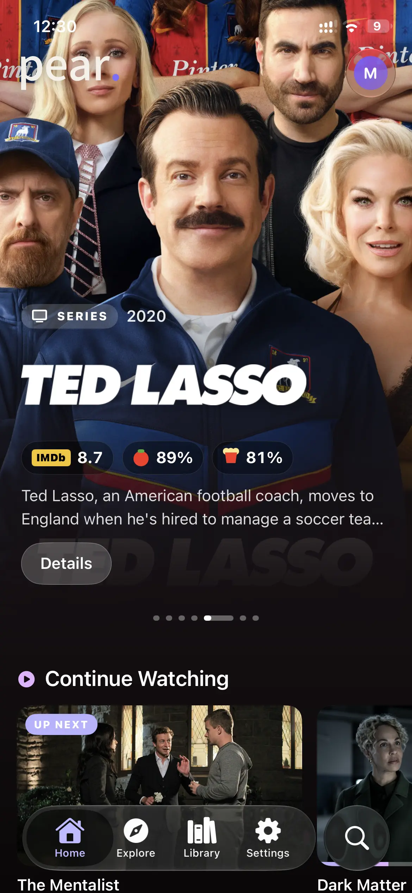
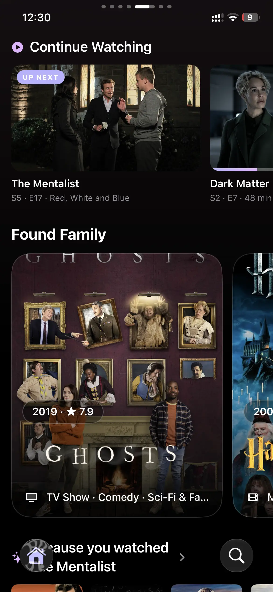
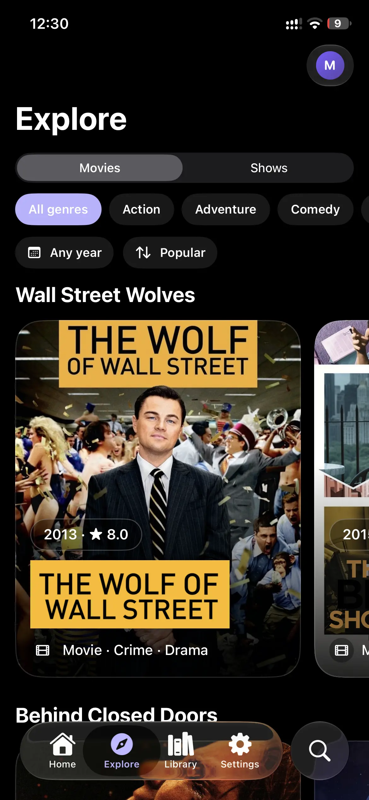
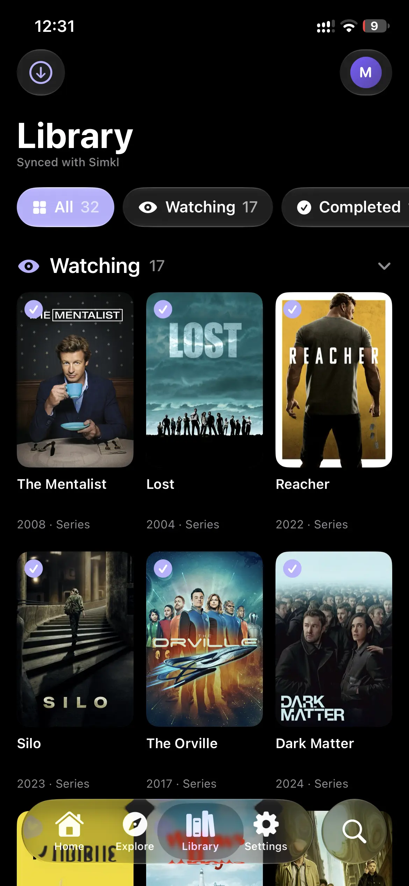
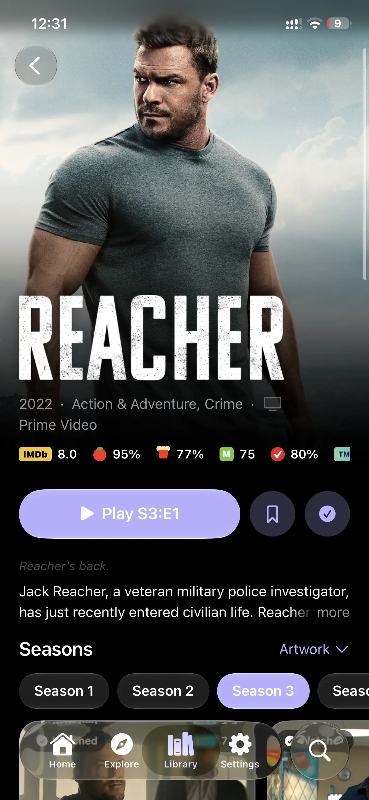
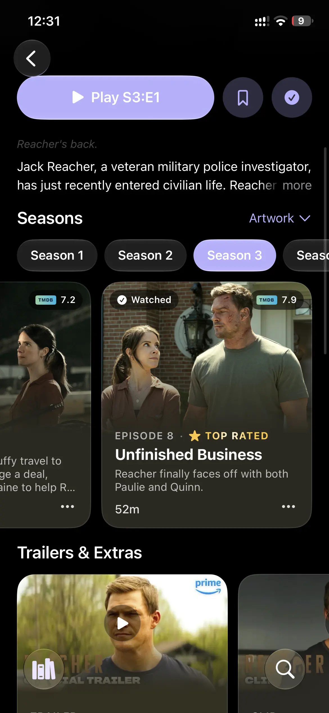
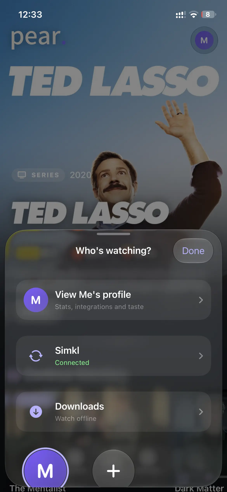
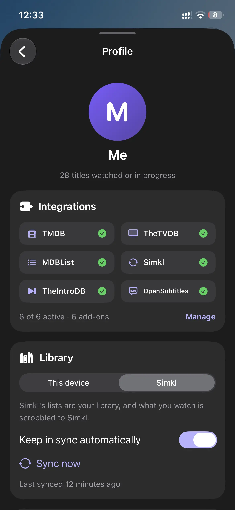
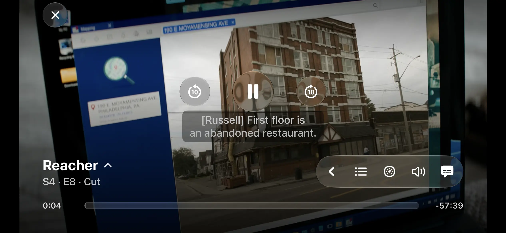
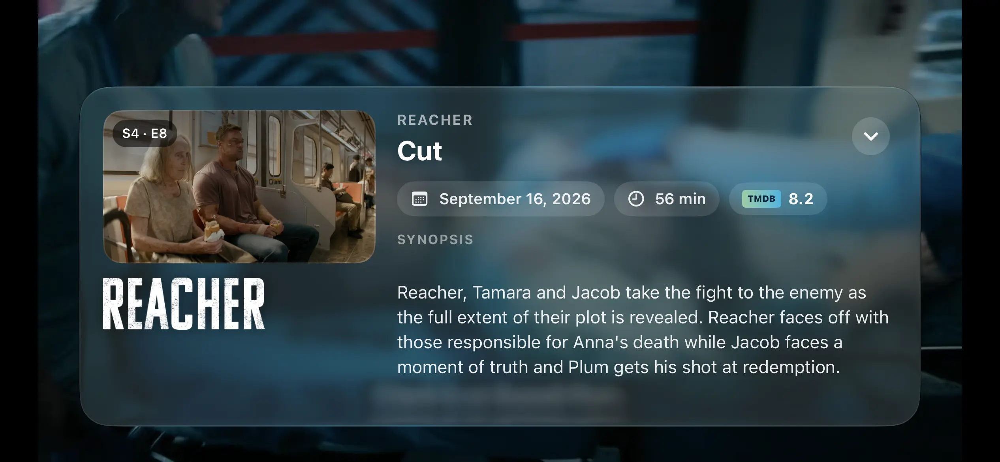

# Pear.

**Your whole watch life in one native iOS app.**

Pear. brings your library, your watch history, your Stremio add-ons, your Jellyfin and Plex servers and an optional peer-to-peer engine into a single app. It plays everything in a hardware-accelerated native player, wrapped in an iOS 26 Liquid Glass interface that goes easy on your battery.

It's pure SwiftUI: no web views, no cross-platform shell. It runs on iPhone and iPad, and each profile gets its own history, library and content rules.

> Pear. doesn't host, provide or index any media. Sources come only from the add-ons, servers and links you add yourself. Everything is saved per profile and stays on your device unless you connect a service.

## Screenshots

<p align="center">
  
  
  
  
</p>
<p align="center">
  
  
  
  
</p>
<p align="center">
  
  
</p>

## At a glance

| | |
|---|---|
| **Native iOS** | Swift and SwiftUI built for iOS 26, on iPhone and iPad |
| **Native player on AetherEngine** | FFmpeg demuxing with VideoToolbox hardware decoding. MKV and nearly every audio codec at native-player battery cost |
| **Liquid Glass interface** | System glass on the profile button, navigation and player controls, with a full-bleed hero and collapsing title pages |
| **Battery-aware and smooth** | Animations stop when a page is hidden, and go static in Low Power Mode or when the phone runs hot |
| **Integrations** | TMDB, TheTVDB, MDBList, Simkl, TheIntroDB and OpenSubtitles, with a TMDB key built in |
| **Stremio add-ons** | Install any add-on, reorder them, pin sources. AIOMetadata gets its own catalogue picker |
| **Peer-to-peer** | An embedded Rust torrent engine for streams, off by default, Wi-Fi-only option, and it only exists while a stream is playing |
| **Jellyfin and Plex** | Your own libraries are offered first, ahead of every add-on |
| **Picture in Picture** | Opens automatically when you leave the app mid-video |
| **Downloads** | Save movies, episodes or whole seasons to watch offline, with transfers that continue in the background |
| **Profiles** | Up to eight, each with its own history, library, content filters and stats |

## Features

### Native player

Pear.'s player is built on [AetherEngine](https://github.com/superuser404notfound/AetherEngine). FFmpeg handles the container and VideoToolbox decodes on the GPU, so MKV files, a wide range of audio codecs and embedded subtitles play at roughly the power cost of the built-in player.

A resumed video opens straight at your saved position rather than loading from 0:00 and then seeking.

On top of that:

- Speed from 0.5x to 2x on a slider that snaps to 1x
- ±10 second skips, with rapid taps merged into a single seek so remote files don't rebuffer on every tap
- A seek bar that shows how far ahead is buffered
- Audio track switching, background audio, and automatic landscape for playback
- Autoplay for the next episode
- A controls pill you arrange yourself: pin and reorder Speed, Episodes, Sources, Volume, Picture in Picture, Subtitles, Audio track and Next episode

### Skip intro, recap and credits

Skip buttons appear for intros, recaps, credits and previews, using community-verified timestamps from [TheIntroDB](https://theintrodb.org). There's no account or key. For shows it doesn't know, an optional manual button jumps ahead by a time you choose.

### Subtitles

Subtitles come from the file or from OpenSubtitles, with no account or API key. Your preferred language is listed first, then the best file for every other language. The style editor has a live preview and controls size (12 to 72 px), colour, font (System, Rounded, Serif, Mono), weight, edge (none, shadow, outline), background opacity and distance from the bottom. Change it inside the player and it becomes your default.

### Liquid Glass interface

The interface is built for iOS 26. The profile avatar, navigation and player controls use system glass. Title pages have a collapsing hero with parallax, and the title shows as a clear logo when one exists. Episode cards are tinted from the colour of their own still. Pick an accent colour and the whole app follows it live. If a device ever struggles, glass controls can be switched off in one toggle.

On iPad you get a sidebar layout with your profile, the main destinations and your add-on catalogues, and every page keeps its own navigation stack and scroll position. iPhone can use the same layout in landscape if you opt in.

### Battery-aware

A lot of the app is built around keeping battery use low.

- Pages that aren't on screen stop animating. That covers pages hidden behind another page, pages behind a sheet, and everything while the app is in the background.
- In Low Power Mode, or when the phone is running hot, decorative motion switches to static versions. Nothing functional changes.
- Alternate poster artwork only rotates in on an unrestricted Wi-Fi connection.
- Images are downsampled to the size they're shown at. Each URL downloads once however many views want it, and downloads are cancelled when you scroll past.
- Permanent facts like ids, genres and networks are cached on disk forever, so the radio isn't woken to ask again.
- Download progress, the loader and the seek bar are all throttled to what you can actually see.
- The P2P engine tears itself down on idle, background, memory pressure and network changes.

### Jellyfin and Plex

Sign in to **Jellyfin** (password or Quick Connect) and **Plex** (through Plex's own login page, so your password never touches the app, and every server on the account is offered). When a title is in your own library it's listed above every add-on in the sources sheet, the player's source switcher and next-episode lookup. Files direct-play, one source per version of the file.

Each server also adds "New" rows to Home and joins search. Plex tries its other connections (LAN, remote, relay) if the saved one stops answering. Tokens live in the Keychain and aren't included in backups.

### Stremio add-ons and peer-to-peer

Paste a manifest link and the add-on is in. Drag to reorder, switch off without removing, reload, open the add-on's setup page, or swipe to remove it. The order you set controls Home rows, search and sources. Add-on URLs are never shown in full, because debrid links carry API keys.

Swipe a source to **pin it to the top for that show**. Pear. remembers it and prefers the same source for the next episode.

**AIOMetadata** support is built in. These add-ons can serve dozens of catalogues, so none are shown until you pick them on a dedicated screen. They then get Home rows, and their genres and title logos enrich Pear.'s themed rows.

For torrent sources, Pear. has its own engine: a Rust core built on [librqbit](https://github.com/ikatson/rqbit). It's off by default, and when it's off torrent sources are hidden and nothing P2P starts. There's a Wi-Fi-only option that ends the stream the moment you leave an allowed network. The engine exists only while a P2P stream is playing. When it's paused it's kept briefly for an instant resume, then released and its cache deleted.

> Torrent streams connect directly to other peers, so they can see your IP address. Use a VPN. Nothing runs until you play a P2P stream.

### Profiles

Up to eight profiles, each with its own watch history, local library, content filters and statistics. Give a profile a colour and icon, or let it use your Simkl name and picture.

Content filters are per profile, so a kids' profile can hide what yours doesn't. There are fourteen categories to switch off: Anime, Cartoons & animation, Kids & family, Documentaries, Reality TV, Talk shows & news, Soap operas, Horror, Romance, Asian film & TV, Indian & South Asian, Other foreign-language, Music & musicals and TV movies. Hidden titles disappear from Home, Explore, recommendations, themed rows and "See all" pages. Continue Watching and your library are never filtered. Most titles are classified from data they already carry, and the rest cost one cached TMDB lookup, ever.

### Profile stats

Each profile page turns your history, library and real playback time into stats:

- Titles watching, saved and completed, and episodes seen
- Total watch time, split into shows and movies, with a daily average
- Your genre mix, weighted by time spent, so a long series counts more than a short film
- How recent your watching is, and the median year of what you watch
- Your favourite time of day and peak hour

### Picture in Picture

A PiP button sits in the player, and leaving the app mid-video opens the floating window automatically. It's built on the native player layer, so it wraps what's already on screen. PiP isn't available for software-decoded AV1 and VP9. It can be switched off, which also removes the button.

### Downloads

Pear. can save videos to your device so you can watch without a connection.

- **What you can download:** a movie, a single episode, or a whole season. Long-press a movie's Play button, an episode or a season and choose Download. You can also open the sources sheet in download mode and pick the exact source you want.
- **Whole seasons:** every episode that has aired is queued in order and downloaded one at a time. Each episode's link is resolved right before it starts, so nothing goes stale while it waits. Later episodes reuse the same add-on and release as the rest of the season where they can, then your pinned source.
- **Background transfers:** downloads run on a background session, so they keep going when you leave or close the app, and iOS wakes Pear. when they finish.
- **Control:** pause, resume, retry or cancel each item, or pause everything at once. The speed readout updates live and says "Stalled" if a transfer stops sending data.
- **Storage:** the Downloads page groups everything by show and season, and shows how much space it uses and how much is free on the device. It's reachable from your profile.
- **Badges:** episodes show their download state on the episode card, so you can see what's saved, queued or failed.
- **Playback:** downloaded files open in the same native player, and share watch history and resume points with online playback.
- **Offline start:** if you launch with no connection, the app opens on Downloads with a banner to switch to the full app once you're back online. It never switches by itself, so it won't interrupt anything you're watching.

Downloads need a plain HTTPS file link. Torrent (P2P) streams can't be downloaded, and neither can HLS playlists, since they aren't a single file.

### Integrations

TMDB is built in, so trending, Explore, recommendations, episode thumbnails and logos work from the first launch, and you can add your own key if you want to. Simkl sign-in is a PIN: tap Connect and enter the code at simkl.com/pin, with no app registration. MDBList adds ratings and your lists, and TheTVDB fills in missing episode art and logos.

| Service | What it does | Key |
|---|---|---|
| TMDB | Metadata, posters, trending, recommendations, trailers, logos, skip-intro matching | Built in, or your own |
| TheTVDB | Extra episode art and title logos | Optional (plus a PIN for subscriber keys) |
| MDBList | IMDb, Rotten Tomatoes, Metacritic and Letterboxd ratings, plus your lists on Home | Optional |
| Simkl | Sign-in, library, history, sync | PIN login |
| TheIntroDB | Skip intro, recap, credits | None |
| OpenSubtitles | Online subtitles | None |
| Metahub | Fallback title logos | None |
| Jellyfin and Plex | Your own libraries | Your account |

### Discovery

Home shows themed collections like "Small-Town Secrets" and "K-Drama Fever". There are about 65 themes. Each day brings a fresh slate of ten: five on Home, three on Explore and spares in case a theme comes up empty. Nothing repeats until every theme has had a turn, consecutive days never overlap, and Home and Explore never share one.

The Home hero is a carousel of trending movies and shows that changes daily. Explore has a Movies/Shows switch, genre chips, a year picker and sorting by Popular, Top rated or Newest. Titles can also rotate through alternate posters and backdrops.

### Library, with or without Simkl

Each profile chooses where its library lives. **On this device**, it keeps its own history and watch time and never contacts Simkl. With **Simkl**, your Simkl lists are the library and playback is scrobbled. Sync merges the two and never deletes anything on either side.

## Everything else

**Home**
- Continue Watching reopens the show on the episode you were on, and UP NEXT cards offer the next episode once it has aired
- "Because you watched…" recommendations, trending movies and shows, and your MDBList lists
- Add-on catalogues in your order (a 12-row cap, with hidden catalogues skipped before it counts)
- Touch and hold any row title to hide it
- "See all" pages with endless scrolling, grouped by release year
- If a refresh fails, the page keeps what it was showing instead of blanking

**Search**
- Add-ons are asked first (they return IMDb ids), then TMDB fills the gaps, and your media servers are searched too
- Optionally apply your content filters to search results

**Title pages**
- Ratings from IMDb, Rotten Tomatoes, Metacritic, Letterboxd and TMDB
- Year, runtime, genres, network or studio, cast and an expandable synopsis
- A season and episode browser with the best-rated episode of each season marked, and unaired episodes greyed out with their date
- Trailers & Extras in an in-app viewer, and a "More like this" row that respects your filters
- Sources stream into the sheet as each add-on answers, with a dropdown to narrow to one add-on
- Mark watched or unwatched for a title, a season or "everything up to here"

**Settings and backup**
- One Integrations screen for every service
- Export and import as a file, or copy and paste through the clipboard as a fallback. It covers keys, add-ons, appearance, playback and subtitle settings, profiles, pinned sources and content settings, with watch history and libraries optional. The Simkl login is not included, and clipboard copies clear after five minutes
- Keychain storage with a sandbox fallback for sideloaded and containerised installs such as LiveContainer, so you aren't logged out on every launch

**Little touches**
- The launch animation, where the P turns into a face, winks and settles into the "pear." wordmark, with a looping version while a stream opens
- Optional network icons on posters and logos in place of title text
- Portrait by default, with landscape unlocked for the player

## First launch

A short setup that you can skip at any step: welcome, profile (sign in with Simkl or type a name), accent colour, content filters, Home rows and an add-on link, and optional API keys. All of it can be changed later in Settings. Anyone updating from an older build never sees it.

## Build it

You'll need Xcode 26, [XcodeGen](https://github.com/yonaskolb/XcodeGen) (`brew install xcodegen`) and Rust from [rustup](https://rustup.rs). The project links the P2P engine, so build it once even if you never turn P2P on.

```bash
# build the Rust engine into Vendor/P2PCore.xcframework
cd p2p-core && make xcframework && cd ..

# generate the Xcode project from project.yml
xcodegen

open MediaHub.xcodeproj
```

Run it on an iOS 26 simulator or device. For an unsigned IPA, run the manual **Build IPA** workflow from the GitHub Actions tab. It builds the Rust core with a Cargo cache, runs XcodeGen, builds Release and uploads `MediaHub.ipa`.

| | |
|---|---|
| Display name | Pear. |
| Bundle ID | `com.mediahub.pear` |
| Version | 0.1.0 (build 1) |
| Deployment target | iOS 26.0 |
| Devices | iPhone and iPad |

## Code layout

```
MediaHub/
  MediaHubApp.swift   app entry, theme, root view
  Core/               API clients, stores, models, caches, content rules
  Features/           SwiftUI screens
  Servers/            Jellyfin and Plex backends
  P2P/                Swift side of the torrent engine
p2p-core/             Rust crate (librqbit + UniFFI)
.github/workflows/    Build IPA
project.yml           XcodeGen definition
```

Jellyfin and Plex plug in as synthetic add-ons (`Addon.server`), so pins, filters, the player and Home need no special cases for them. TMDB lists come back as `tmdb:<id>` and the IMDb id is only resolved when you open a title, so a list costs one request instead of one per item. A new content category is a case in `ContentCategory` plus its TMDB genre ids, and a new themed row is an entry in `ThemeCatalog.all`.

## Not done yet

- Progress isn't reported back to Jellyfin or Plex
- No transcoding, and no external subtitle tracks from Jellyfin or Plex
- Downloads need a plain HTTPS file link. Torrents and HLS playlists can't be downloaded
- Jellyfin and Plex titles are matched by IMDb id, so a title without one won't be found
- PiP isn't available for software-decoded AV1 and VP9

## Credits and licences

- [AetherEngine](https://github.com/superuser404notfound/AetherEngine), the player engine. LGPL, with an App Store exception for the engine's own code.
- FFmpeg and codecs, bundled through [FFmpegBuild](https://github.com/superuser404notfound/FFmpegBuild) and built without GPL or version-3 options. FFmpeg is LGPL-2.1-or-later, dav1d is BSD-2-Clause, zimg is WTFPL and libzvbi is LGPL-2.0-or-later. Full licence texts and the exact build source are in that repository.
- [librqbit](https://github.com/ikatson/rqbit), the BitTorrent engine behind optional P2P. Apache-2.0. It's bridged with UniFFI (MPL-2.0) and uses Tokio and Hyper (MIT).

The services above are used through their public APIs under their own terms and aren't open source. This product uses the TMDB API but is not endorsed or certified by TMDB. Metadata is provided by TheTVDB. Pear. isn't affiliated with TheTVDB, MDBList or Simkl, and Simkl hasn't endorsed it. Service names and logos belong to their owners.
